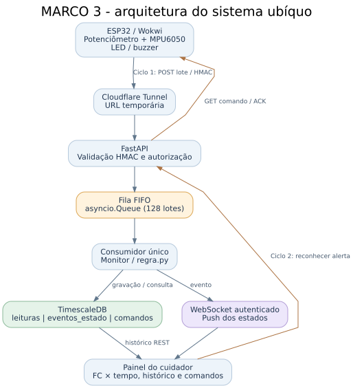

# Marco 3 — Monitoramento ubíquo com processamento de eventos

**Universidade Federal de Goiás · INF · Software para Sistemas Ubíquos · 2026/2**

Este diretório contém o sistema de monitoramento didático com sensores sintéticos, ESP32 virtual no Wokwi, API FastAPI, fila FIFO, histórico temporal TimescaleDB, WebSocket e o ciclo inverso de comandos. Os arquivos das etapas anteriores são mantidos no repositório para preservar a evolução do projeto.

## 1. Requisitos do trabalho e da evolução solicitada

| Aspecto | Implementação no Marco 3 |
|---|---|
| Comunicação e integração | HTTP/REST do dispositivo à API, WebSocket da API ao navegador e túnel temporário Cloudflare |
| Segurança, identidade e autorização | Assinatura HMAC-SHA256 por dispositivo, timestamp, vínculo com paciente fictício e sessão de cuidador |
| Dois ciclos produtor-consumidor | Leituras ESP32 → API; comando cuidador → ESP32 → confirmação ACK |
| **Fila de mensagens** | `asyncio.Queue(maxsize=128)` com um consumidor FIFO, deduplicação de lote e códigos 503 para saturação |
| **Banco temporal** | TimescaleDB com hypertables `leituras`, `eventos_estado` e `comandos` |
| **WebSocket** | `/ws/pacientes/{id}`, autenticado por sessão; eventos enviados após processamento e mudanças de comando |
| **Simulação aprimorada** | Cenários de normalidade, FC elevada em repouso, movimento, sensor inválido, falha/reconexão e ciclo automático |
| Visualização e análise | Gráfico de FC × tempo, métricas da fila, estados, histórico e consulta ao TimescaleDB |

## 2. Arquitetura

**Produtor do ciclo 1:** ESP32 lê potenciômetro (FC fictícia) e MPU6050 (aceleração). Cada segundo obtém uma amostra; a cada três leituras envia um lote HTTP assinado. **Consumidor do ciclo 1:** FastAPI valida o lote, coloca-o na fila e um único consumidor aplica `Monitor` de `regra.py`.

**Persistência:** `armazenamento.py` escreve no TimescaleDB; `temporal.py` é somente o adaptador de integração, **não outro banco**. Leituras, transições e status dos comandos são registrados separadamente.

**Atualização instantânea:** depois de calcular o estado, a API publica um evento para os navegadores autenticados por WebSocket. O painel faz consultas REST de contingência apenas quando o socket não está aberto.

**Produtor do ciclo 2:** o cuidador solicita reconhecer um alerta ativo. **Consumidor do ciclo 2:** o ESP32 consulta comandos a cada três segundos, silencia o buzzer, envia ACK e a API atualiza o painel e o histórico de comandos.

Em falha de comunicação por oito segundos, a ESP32 entra em **modo local**, usando uma regra simples; o servidor classifica ausência de leituras como `DADOS_INSUFICIENTES`. Estado e comandos pendentes não são reconstituídos a partir do banco após reiniciar a API.

## 3. Regra de contexto

O servidor trabalha com janelas de **10 amostras de FC** e **5 de movimento**. Uma avaliação só é considerada suficiente com cobertura mínima de **70%** em ambas. Com FC média acima de **100 bpm em repouso**, por duas avaliações consecutivas e respeitando permanência mínima de quatro segundos, o estado entra em `ATENCAO`; a saída utiliza **92 bpm**, caracterizando histerese. Amostras inválidas ou silêncio de oito segundos conduzem a `DADOS_INSUFICIENTES`.

O gráfico do painel mostra as amostras individuais e **não substitui** a decisão baseada na média móvel. [Veja os diagramas e a explicação dos gráficos](docs/DIAGRAMAS_E_GRAFICOS.md).

## 4. Banco de dados temporal

| Hypertable | Campos principais | Finalidade |
|---|---|---|
| `leituras` | `ts`, `patient_id`, `device_id`, `lote_id`, `fc`, `g` | Amostras para histórico e gráfico |
| `eventos_estado` | `ts`, `estado`, `razao`, `fc_media`, `movimento`, coberturas | Evidência das transições calculadas |
| `comandos` | `ts`, `command_id`, `tipo`, `status`, `emitido_por` | Trilha do ciclo inverso (PENDENTE, ENTREGUE, EXECUTADO) |

As três tabelas são convertidas em hypertables usando a extensão TimescaleDB. A persistência é opcional para operar a API localmente, mas necessária para o histórico durável. O backend não armazena uma fila offline de reenvio em caso de indisponibilidade do banco.

## 5. Interface e rotas

| Rota | Autorização | Papel |
|---|---|---|
| `GET /api/saude` | Pública, sem dados de paciente | Diagnóstico técnico |
| `POST /api/leituras` | HMAC, dispositivo/paciente | Receber lote de até 10 leituras |
| `GET /api/pacientes/{id}/estado` | Sessão cuidador | Estado, métricas, histórico recente |
| `GET /api/pacientes/{id}/historico` | Sessão cuidador | Leituras históricas por TimescaleDB |
| `WS /ws/pacientes/{id}` | Sessão cuidador | Atualização contínua do painel |
| `POST /api/pacientes/{id}/comando` | Sessão cuidador | Reconhecimento de alerta |
| `GET /api/dispositivo/comando` | HMAC, dispositivo/paciente | Entrega de comando pendente |
| `POST /api/dispositivo/comando/ack` | HMAC, dispositivo/paciente | Confirmação de execução |

As mensagens autenticadas usam o cabeçalho `X-Timestamp` (segundos Unix) e `X-Assinatura` (HMAC-SHA256 da hora, método, rota e corpo). A chave não trafega. A comunicação ESP32–API permanece HTTP, sem criptografia TLS no trecho inicial do simulador; não utilize dados reais nem divulgue a chave da simulação.

## 6. Simulações do ESP32

| Tecla no Serial Monitor | Cenário | Resultado conceitual |
|---|---|---|
| `0` | Manual (potenciômetro e MPU6050) | Observa o estado conforme entradas virtuais |
| `1` | FC normal, repouso | Evolução para NORMAL com cobertura adequada |
| `2` | FC elevada, repouso | ATENCAO após janela e persistência |
| `3` | FC indisponível | DADOS_INSUFICIENTES ao perder cobertura |
| `4` | FC elevada, com movimento | Demonstra que FC alta isolada não implica alerta em repouso |
| `a` | Ciclo automático | Normal → alerta → sem FC → recuperação |
| `f` | Falha de comunicação | Modo local no ESP32 e ausência de dados no servidor |

A FC é gerada por potenciômetro/cenários, **não por sensor médico**. O botão de falha do circuito tem a mesma função da tecla `f`.

## 7. Instalação e demonstração

Siga **um único guia padronizado**: [GUIA_EXECUCAO_E_TESTES.md](docs/GUIA_EXECUCAO_E_TESTES.md), com instalação Windows, dependências (incluindo `websockets`), credenciais, SQL, Wokwi, cenário automático, consultas e diagnósticos. Consulte também o [roteiro de 10 minutos](docs/roteiro-apresentacao.md).

Os arquivos `.env` e `config.h` são criados localmente por `api/gerar_config.py`, preservam a chave comum da API e ESP32 e ficam fora do GitHub. O endereço do túnel é temporário e deve ser atualizado na cópia privada do Wokwi a cada nova execução.

## 8. Escolhas e limites de escopo

- **Sem broker externo:** fila FIFO em memória é suficiente para ilustrar o padrão produtor-consumidor, mas perde conteúdo em reinicializações.
- **Um processo:** não executar múltiplos workers Uvicorn; estado, fila e comando são locais ao processo.
- **Sem garantia de persistência durante falha:** gravações perdidas na indisponibilidade do banco são contabilizadas; não há retentativa durável.
- **Sem transporte TLS no trecho Wokwi:** HMAC oferece integridade/autenticidade da mensagem, não confidencialidade.
- **Sem finalidade médica:** dados sintéticos e identificadores fictícios.

Arquivos complementares: [`decisoes.md`](docs/decisoes.md), [`ORIGEM_CONSOLIDACAO.md`](docs/ORIGEM_CONSOLIDACAO.md), [`arquitetura.mmd`](docs/arquitetura.mmd) e [`sql/timescaledb.sql`](api/sql/timescaledb.sql).
