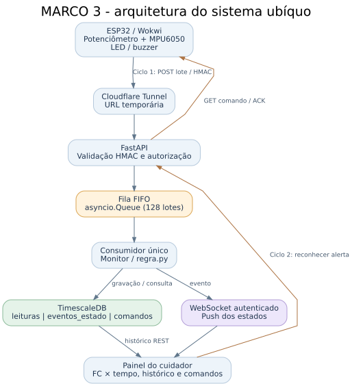
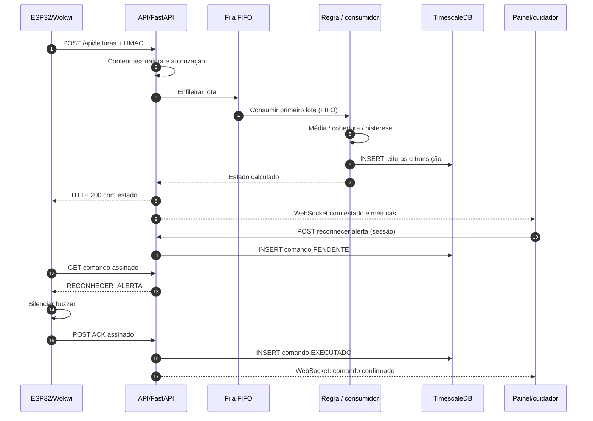
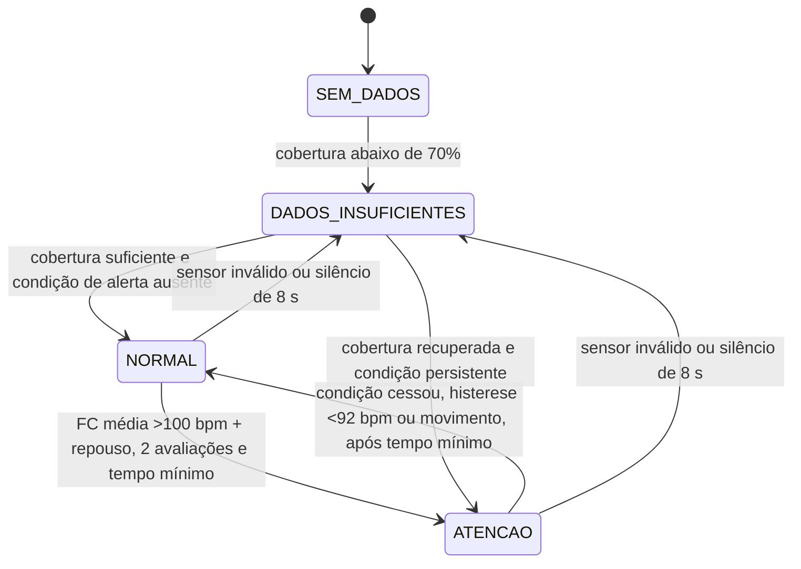

# Arquitetura, fluxos, estados e gráficos — Marco 3

Esta página explica as visualizações da entrega. Os dados representados no ESP32 e nos gráficos são **sintéticos** e não devem ser interpretados como medidas clínicas.

## Diagrama 1 — Arquitetura final



- **Sensores virtuais:** o potenciômetro produz frequência cardíaca simulada (FC) e o MPU6050 fornece magnitude da aceleração, em g.
- **Ciclo 1 (telemetria):** cada lote contém até três leituras; a API autentica a mensagem com HMAC e verifica o vínculo paciente/dispositivo, enfileira e aguarda o consumo do lote.
- **Fila FIFO:** `asyncio.Queue(maxsize=128)`, com consumidor único. O painel apresenta `enfileirados`, `processados`, `pendentes` e a sequência dos últimos IDs processados. Os números são contadores de processamento em memória, não taxas calculadas pelo banco.
- **Regra:** `regra.py` processa janela de dez amostras de FC e cinco de movimento, calcula cobertura e decide NORMAL, ATENCAO ou DADOS_INSUFICIENTES.
- **Banco temporal:** TimescaleDB mantém históricos de amostras, mudanças de estado e status de comando em três hypertables. Os registros sobrevivem ao reinício da API; o estado corrente em memória não.
- **WebSocket:** a API envia o estado atualizado ao navegador assim que o consumidor termina o lote. HTTP REST é usado quando o WebSocket não está aberto e para consultar o histórico.
- **Ciclo 2 (comandos):** cuidador produz reconhecimento de alerta → ESP32 consome comando por HTTP → buzzer é silenciado → ESP32 confirma ACK → API registra status e notifica o painel.

## Diagrama 2 — Sequência de mensagens



## Diagrama 3 — Estados da regra



**Nota:** o desenho simplifica transições intermediárias; `regra.py` é a fonte exata da máquina de estados e pode manter uma condição anterior até terminar o tempo mínimo.

## Gráfico 1 — Frequência cardíaca × tempo (painel)

O gráfico é desenhado por JavaScript no `canvas` de `api/templates/painel.html` com dados recebidos do WebSocket ou consultados em `/api/pacientes/{id}/historico`.

| Elemento visual | Interpretação |
|---|---|
| Eixo X (horário) | Horários UTC recebidos, exibidos na hora local do navegador |
| Eixo Y (bpm) | FC sintética individual na faixa aceita pela regra (30–220 bpm) |
| Linha contínua azul | Sequência temporal das leituras válidas |
| Espaço no traçado | Leitura inválida ou ausente (`null`) |
| Linha horizontal tracejada em 100 bpm | Referência didática de entrada **na média móvel em repouso**, não limiar instantâneo de cada amostra |
| Botão **Consultar histórico** | Obtém as leituras persistidas e as desenha em ordem cronológica crescente |

O gráfico em tela contém as leituras recentes em memória. O histórico consultado no banco retorna até 500 pontos (por padrão 100; o painel solicita 80). O valor `100 bpm` é somente referência: **a condição real exige cobertura, repouso, avaliações consecutivas e tempo mínimo**.

### Exemplo didático de como a regra reage (não são resultados de execução)

| Período ilustrativo | FC sintética | Movimento | Interpretação |
|---|---:|---|---|
| Normalidade | 78 bpm | 1,0 g | Após a janela preencher, tende a `NORMAL` |
| FC elevada em repouso | 135 bpm | 1,0 g | Após avaliações persistentes, `ATENCAO` |
| FC elevada em movimento | 135 bpm | 1,75 g | A regra não trata FC elevada durante atividade como alerta de repouso |
| Sensor sem FC | `null` | 1,0 g | Cobertura da FC diminui; pode chegar a `DADOS_INSUFICIENTES` |
| Recuperação | 78 bpm | 1,0 g | Média e cobertura se recuperam gradualmente |

## Gráfico 2 — Métricas da fila

O painel não mostra latência inventada nem desempenho estimado. Exibe contadores reais da execução corrente: lotes `enfileirados`, `processados`, `pendentes` e IDs processados. **O tamanho da fila pode permanecer zero** porque o consumidor é rápido; isso não significa ausência de fila. O código contém a chamada `fila.put_nowait` no produtor e `await fila.get()` no consumidor.

## Gráfico 3 — Histórico temporal no SQL

As três hypertables são indexadas pela coluna `ts` (`TIMESTAMPTZ`) e podem ser consultadas para explicar volume e transições. No SQL Editor, por exemplo:

```sql
SELECT time_bucket('1 minute', ts) AS minuto,
       ROUND(AVG(fc)::numeric, 1) AS fc_media,
       COUNT(fc) AS leituras_validas
FROM leituras
WHERE patient_id = 'patient-0042'
GROUP BY minuto
ORDER BY minuto;

SELECT ts, estado, razao, fc_media, movimento
FROM eventos_estado
WHERE patient_id = 'patient-0042'
ORDER BY ts DESC LIMIT 20;

SELECT ts, command_id, status, emitido_por
FROM comandos
WHERE patient_id = 'patient-0042'
ORDER BY ts DESC LIMIT 20;
```

`time_bucket` é um recurso da extensão TimescaleDB e permite agrupar leituras em intervalos de tempo para construir séries históricas. O eixo temporal de cada amostra é estimado pelo servidor a partir do horário de chegada do lote e da frequência de uma amostra por segundo; não se trata de timestamps individualmente sincronizados na ESP32.

Para o passo a passo completo, consulte [GUIA_EXECUCAO_E_TESTES.md](GUIA_EXECUCAO_E_TESTES.md).
