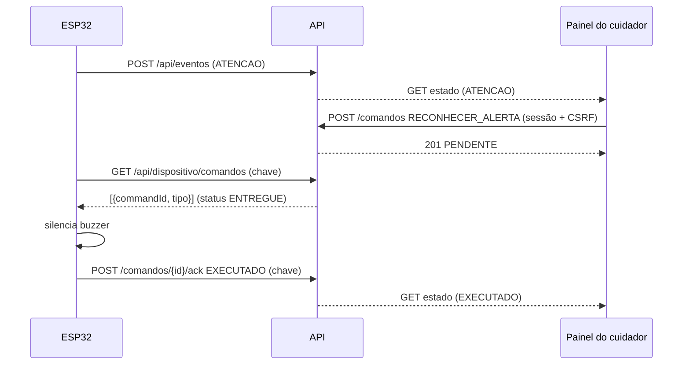

# Ciclo produtor-consumidor 2: comando do cuidador e confirmação do dispositivo

O Marco 3 mantém o ciclo 1 (ESP32 produz evento, API/painel consomem) e fecha um
segundo ciclo em que **os papéis se invertem**: o consumidor do ciclo 1 vira produtor.

| Etapa | Produtor | Consumidor | Canal | Autorização |
|---|---|---|---|---|
| 1. evento de estado (ciclo 1) | ESP32 | API → painel | `POST /api/eventos` (HTTPS) | `X-Device-Key` + vínculo device↔paciente |
| 2. comando `RECONHECER_ALERTA` | **cuidador (painel)** | API | `POST /api/pacientes/{id}/comandos` | sessão + CSRF + vínculo cuidador↔paciente + só em `ATENCAO` |
| 3. entrega do comando | API | **ESP32** | `GET /api/dispositivo/comandos` (HTTPS) | `X-Device-Key` + vínculo |
| 4. efeito local | ESP32 | — | buzzer mudo; LED e estado permanecem | — |
| 5. confirmação | **ESP32** | API → painel | `POST /api/comandos/{id}/ack` | `X-Device-Key` + vínculo; só se `ENTREGUE` |

Garantias: comando com TTL de 120 s (`EXPIRADO`); reentrega até o ack (*at-least-once*);
`commandId` e clique repetido idempotentes; ack repetido devolve 200; o cuidador não
consegue forjar ack (exige a chave do dispositivo) e o dispositivo não consegue emitir comando
(exige sessão).

Decisão de segurança: reconhecer **não** muda o estado nem apaga o LED. Só `NORMAL` encerra o
alerta, como no Marco 2 (perder atenção do cuidador não prova que o risco passou).
