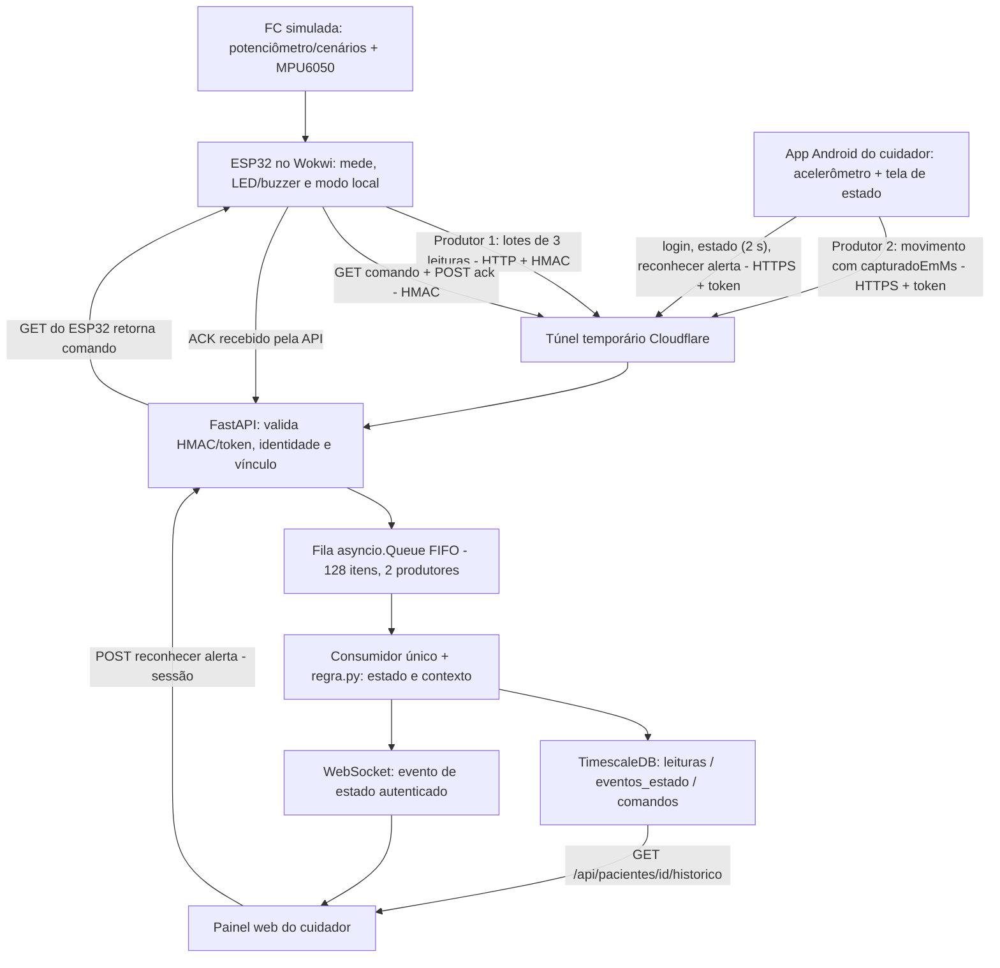

# Marco 4 — Monitoramento ubíquo com app Android e mudança de contexto

**Universidade Federal de Goiás · INF · Software para Sistemas Ubíquos (INF0483) · 2026/2**
Equipe: Felipe Alves, Felipe O Carvalho, Matheus Augusto e Murilo Bernardo.

Um ESP32 virtual (Wokwi) mede a frequência cardíaca (FC) sintética e o movimento de um paciente fictício e envia lotes assinados para uma API FastAPI.
No Marco 4, o **app Android do cuidador** virou o **segundo produtor**: o acelerômetro do celular informa se o paciente está em movimento, e esse contexto **suprime o alerta de FC alta**.
A API junta os dois produtores numa fila FIFO e decide o estado (`NORMAL`, `ATENCAO`, `DADOS_INSUFICIENTES`).
Os estados, leituras e comandos ficam gravados no **TimescaleDB**.
O cuidador acompanha pelo app ou pelo painel web e reconhece o alerta, o que silencia o buzzer do ESP32 (ciclo de resposta com ACK).

> **Escopo:** protótipo acadêmico com dados sintéticos e identificadores fictícios, sem finalidade médica. Nenhum dado pessoal real é coletado.

---

## Vídeo do Marco 4

**Link:** _a preencher depois da gravação_
**Versão demonstrada:** tag `marco4`, commit _a preencher_.

---

## Itens obrigatórios do Marco 4

| Item | Onde está | Situação |
|---|---|---|
| **1. Aplicativo móvel** | Código em [`mobile/`](mobile/) (Kotlin + Compose) · instruções em [`mobile/README.md`](mobile/README.md) · APK em [`apk/`](apk/) · contrato em [`contrato/app-v1.json`](contrato/app-v1.json) | ⏳ código pronto; falta gerar e testar o APK |
| **2. Persistência de dados** (banco temporal) | [`api/armazenamento.py`](api/armazenamento.py), esquema em [`api/sql/timescaledb.sql`](api/sql/timescaledb.sql) (3 hypertables) · verificação em [`scripts/verificar_banco.py`](scripts/verificar_banco.py) | ✅ TimescaleDB |
| **3. Testes automatizados** | [`testes/`](testes/), 44 testes · comandos, módulos e resultados em [`docs/verificacao.md`](docs/verificacao.md) · CI em [`../.github/workflows/testes.yml`](../.github/workflows/testes.yml) com relatório JUnit | ✅ unitários e de API |
| **4. Documentação técnica de implantação** | [`docs/implantacao.md`](docs/implantacao.md): versões, credenciais de teste, banco, ordem de execução e APK | ✅ |
| **5. Relatório técnico (artigo)** | [`docs/artigo.pdf`](docs/artigo.pdf), 14 páginas · fonte LaTeX em [`docs/artigo/artigo.tex`](docs/artigo/artigo.tex) · números de [`scripts/avaliar.py`](scripts/avaliar.py) | ✅ (resultados do ensaio com o APK entram na versão de 11/12) |

### Requisitos mantidos

| Requisito | Onde está |
|---|---|
| Dois produtores, decisão e resposta | Produtor 1: ESP32 ([`produtor/sketch.ino`](produtor/sketch.ino)) · Produtor 2: acelerômetro do app ([`mobile/.../Movimento.kt`](mobile/app/src/main/java/br/ufg/coisos/Movimento.kt)) · decisão: [`api/regra.py`](api/regra.py) · resposta: comando `RECONHECER_ALERTA` → ESP32 silencia o buzzer → ACK |
| Mudança de contexto | Movimento do celular nos últimos 6 s faz o paciente contar como "em movimento", e o alerta de FC alta é suprimido ou encerrado (`razao = movimento_no_celular`). Decisão D27 em [`docs/decisoes.md`](docs/decisoes.md) |
| Contratos e validação | ESP32: [`contrato/leituras-v3.json`](contrato/leituras-v3.json), [`contrato/comando-v1.json`](contrato/comando-v1.json) · app: [`contrato/app-v1.json`](contrato/app-v1.json) · validação de tipos, faixas e tamanho do lote em [`api/app.py`](api/app.py) |
| Regra com estado, tempo e combinação | Janela de 10 leituras de FC e 5 de movimento, cobertura mínima de 70%, persistência por 2 avaliações, histerese 100/92 bpm, tempo mínimo de 4 s por estado, silêncio de 8 s, e combinação FC + movimento do ESP32 + movimento do celular |
| Validade e atrasos | Leitura do celular atrasada (mais de 10 s), adiantada (mais de 5 s) ou fora de ordem recebe 422 (D28); assinatura do ESP32 com mais de 120 s recebe 401; contexto do celular vale 6 s |
| Arquitetura e diagrama | Diagrama abaixo · fonte em [`docs/arquitetura.mmd`](docs/arquitetura.mmd) · decisões D1 a D31 em [`docs/decisoes.md`](docs/decisoes.md) |
| Autenticação e autorização | ESP32: HMAC-SHA256 com timestamp · painel: sessão com senha em hash scrypt · app: token Bearer de 8 h · vínculo `esp32-borda-01 → patient-0042 → cuidador01` (401 identidade inválida, 403 fora da permissão) |
| Canal protegido | App: só HTTPS, e o Android valida o certificado do túnel Cloudflare (D30) · ESP32: HTTP + HMAC, sem sigilo (D17, ver limitações) |
| Segredos fora do Git | `api/.env` e `produtor/config.h` gerados por [`api/gerar_config.py`](api/gerar_config.py) e ignorados pelo Git · só [`api/.env.exemplo`](api/.env.exemplo) é versionado · o APK não tem chave nenhuma |
| Falha e recuperação | ESP32 em modo local depois de 8 s sem API (tecla `f`) · API marca `DADOS_INSUFICIENTES` · app mostra erro de rede, mantém o último estado e retoma sozinho · API sem banco continua em memória |

### Verificações pedidas → evidência

Os testes automatizados rodam no CI a cada push na `main` ([última execução](https://github.com/UFG-INF-SSU-2026/Internet-dos-Coisos/actions/runs/46039476817)). O detalhe de cada teste e o roteiro do ensaio completo estão em [`docs/verificacao.md`](docs/verificacao.md).

| Verificação | Testes automatizados | Ensaio completo |
|---|---|---|
| Fluxo e contexto | [`test_app_mobile.py`](testes/test_app_mobile.py): as duas origens na mesma fila · movimento do celular suprime e encerra o alerta · contexto expira · [`test_api.py`](testes/test_api.py): ciclos 1 e 2 | [Seção 2.1](docs/verificacao.md#21-fluxo-e-contexto) |
| Persistência | [`test_consolidacao.py`](testes/test_consolidacao.py): gravação de leituras, transições e comandos e consulta ao histórico (banco simulado) | [Seção 2.2](docs/verificacao.md#22-persistência): SQL antes e depois de reiniciar a API |
| Segurança | Token inválido, forjado ou expirado → 401 · outro paciente → 403 · assinatura errada, corpo alterado ou mensagem antiga → 401 · ESP32 não cria comando e cuidador não forja ACK | [Seção 2.3](docs/verificacao.md#23-segurança): certificado do túnel e app recusando `http://` |
| Falha e recuperação | Silêncio do ESP32 → `DADOS_INSUFICIENTES`, e o celular não tira o paciente desse estado · leitura atrasada não muda o contexto | [Seção 2.4](docs/verificacao.md#24-falha-e-recuperação): tecla `f`, modo avião, API reiniciada |

### Atendimento ao feedback do Marco 3

Os quatro apontamentos foram implementados no commit `f59a370` (06/11/2026).

| Apontamento | Alteração | Evidência | Situação |
|---|---|---|---|
| WebSocket | `WS /ws/pacientes/{id}` autenticado, em [`api/app.py`](api/app.py) e [`api/templates/painel.html`](api/templates/painel.html) | `test_websocket_precisa_sessao`, `test_websocket_envia_estado_ao_receber_leituras` | Atendido |
| Banco temporal | TimescaleDB com 3 hypertables ([`api/armazenamento.py`](api/armazenamento.py), [`api/sql/timescaledb.sql`](api/sql/timescaledb.sql)) | `test_consolidacao.TestarPersistenciaIntegrada` e consulta SQL depois de reiniciar a API (vídeo) | Atendido |
| Melhorar a simulação | Cenários `0`–`4`, `a` e `f` no [`produtor/sketch.ino`](produtor/sketch.ino), com modo local em caso de falha | Serial Monitor e painel (vídeo) | Atendido |
| Transformar em fila | `asyncio.Queue` com consumidor único, deduplicação e 503 quando enche; no Marco 4, a fila recebe também o app | `test_fila_evidencia_ordem_e_contadores`, `test_fila_processa_e_preserva_estado`, `test_leituras_do_celular_passam_pela_fila` | Atendido |

---

## Arquitetura

**Distribuição:**
- **ESP32:** só mede, atua (LED e buzzer) e tem uma regra mínima para quando a rede cai (D5, D7).
- **API:** concentra a decisão, porque é onde os dois produtores se encontram e onde a regra pode ser testada sem simulador.
- **App:** produz contexto e serve de interface do cuidador.
- **Banco:** gerenciado na nuvem, para os dados sobreviverem ao reinício da máquina da API.

### Rotas

| Rota | Quem chama | Autenticação | Papel |
|---|---|---|---|
| `GET /api/saude` | Qualquer um | Nenhuma (sem dados de paciente) | Diagnóstico |
| `POST /api/leituras` | ESP32 | HMAC + vínculo dispositivo/paciente | Produtor 1: lote de leituras |
| `POST /api/app/login` | App | Usuário e senha do cuidador | Gera o token Bearer (8 h) |
| `POST /api/app/leituras` | App | Token + paciente do token | Produtor 2: movimento com hora de captura |
| `GET /api/pacientes/{id}/estado` | App ou painel | Token ou sessão + paciente | Estado, resumo, comando, fila e celular |
| `GET /api/pacientes/{id}/historico` | App ou painel | Token ou sessão + paciente | Histórico (TimescaleDB ou memória) |
| `WS /ws/pacientes/{id}` | Painel | Sessão + paciente | Estado em tempo real |
| `POST /api/pacientes/{id}/comando` | App ou painel | Token ou sessão + paciente | Reconhecer alerta |
| `GET /api/dispositivo/comando` | ESP32 | HMAC + vínculo | Busca o comando pendente |
| `POST /api/dispositivo/comando/ack` | ESP32 | HMAC + vínculo | Confirma a execução |

---

## Como executar

O passo a passo completo está em [`docs/implantacao.md`](docs/implantacao.md). Resumo (PowerShell, na raiz do repositório):

| Ordem | Componente | Comando |
|---|---|---|
| 0 | Ambiente | `py -3 -m venv .venv` e `.\.venv\Scripts\python.exe -m pip install -r marco4\api\requirements-test.txt -r marco4\api\requirements-temporal.txt` |
| 0 | Credenciais | `.\.venv\Scripts\python.exe marco4\api\gerar_config.py` (ou copiar o `.env` do Marco 3) |
| 1 | TimescaleDB | `DATABASE_URL` no `.env`, depois `.\.venv\Scripts\python.exe marco4\scripts\verificar_banco.py` |
| 2 | API | `.\.venv\Scripts\python.exe marco4\api\app.py` |
| 3 | Túnel | `cloudflared tunnel --url http://127.0.0.1:5000` |
| 4 | ESP32 | Cópia privada do Wokwi com `config.h` local, `API_BASE_URL = "http://<túnel>"` |
| 5 | App | Instalar `apk/coisos-cuidador.apk`, informar `https://<túnel>`, `cuidador01` e a senha |

Testes: em `marco4/testes`, rode `python -m pytest -v test_regra.py test_api.py test_melhorias.py test_consolidacao.py test_app_mobile.py`.

---

## Limitações e pendências

Pendências que serão tratadas até a entrega final de 11/12/2026:

| Pendência | Impacto | Justificativa |
|---|---|---|
| TLS no ESP32 | As leituras sintéticas do ESP32 trafegam sem sigilo até a borda da Cloudflare. O HMAC garante integridade e autenticidade, e há replay possível dentro da janela de 120 s | O handshake TLS falhou no sketch do grupo no Wokwi (D17). O app, que é o canal do usuário, já usa HTTPS validado |
| Teste de integração com TimescaleDB real no CI | Um erro de SQL só aparece no ensaio manual | O CI usa banco simulado; subir TimescaleDB no Actions exige serviço Docker e credenciais de teste |
| Testes instrumentados do app | Regressões na interface dependem do ensaio manual | O comportamento de API do app está coberto por `test_app_mobile.py`; os testes instrumentados exigem emulador no CI |
| Recuperar o estado e o comando pendente depois de reiniciar a API | Depois do reinício, o estado recomeça vazio até chegarem novos lotes, e um comando pendente se perde | O histórico está no banco, mas o estado corrente e a fila ficam em memória (D13, D19) |

Outras limitações declaradas:
- **Simulação:** a FC vem de um potenciômetro ou de cenários e não é sinal médico. O paciente e o dispositivo são fictícios.
- **Dados pessoais:** nenhum. O app não coleta localização nem identidade; envia só a intensidade do movimento.
- **Papel do celular:** na demonstração, o mesmo celular é o app do cuidador e o sensor de movimento do paciente. Num cenário real, o sensor ficaria com o paciente.
- **Segurança:**
  - não há limite de tentativas de login;
  - o token não pode ser revogado antes de vencer (D24);
  - a senha do cuidador fica só como hash no `.env`.
  - A chave do ESP32 que ficou versionada em 16/10 (`b419733`) foi removida do Git em 06/11 (`f59a370`), e a chave em uso é diferente.
- **Conectividade:** a URL do túnel gratuito muda a cada reinício. O ESP32 descarta lotes sem rede (D12).
- **Desempenho:**
  - um único processo Uvicorn;
  - fila de 128 itens em memória, com 503 quando enche;
  - o app consulta o estado a cada 2 s.
- **Energia:** o app mantém o acelerômetro ligado (`SENSOR_DELAY_GAME`) e faz duas requisições a cada 2 s enquanto está aberto, o que gasta bateria. Em produção, o envio iria para um serviço em primeiro plano com intervalo adaptativo. O consumo do ESP32 não foi otimizado: ele envia um lote a cada 3 s e consulta comandos a cada 3 s.

---

## Uso de IA

| Ferramenta | Finalidade | Síntese das orientações | Sugestões aproveitadas ou modificadas | Validação |
|---|---|---|---|---|
| Claude Code (Claude Opus 5.5) | Plano do Marco 4; rotas do app na API; regra de contexto; testes; CI com JUnit; esqueleto do app Android; documentação do Marco 4 | Usar o celular como segundo produtor via acelerômetro; token assinado em vez de chave no APK; descartar leitura atrasada pelo horário de captura; mesma fila FIFO para os dois produtores | Aproveitadas: rotas, testes, CI, app e documentos. Modificado durante o trabalho: o teste de supressão passou a aceitar `DADOS_INSUFICIENTES` nos primeiros lotes, porque a janela ainda não está cheia. Corrigido depois da avaliação: a leitura do celular contava para a persistência de entrada e fazia o alerta voltar em 0 s (commit `a94e70b`) | 44 testes locais e no CI (Python 3.10 e 3.12); revisão do grupo; ensaio completo em [`docs/verificacao.md`](docs/verificacao.md) |
| _Ferramentas usadas nos marcos anteriores_ | _a preencher pelo grupo_ | | | |

O grupo é responsável por compreender, testar e explicar todo o material entregue.

## Contribuições individuais

| Integrante | Contribuição no Marco 4 |
|---|---|
| Felipe Alves (202105026) | _a preencher pelo integrante_ |
| Felipe O Carvalho (202011561) | _a preencher pelo integrante_ |
| Matheus Augusto (202305532) | _a preencher pelo integrante_ |
| Murilo Bernardo (202203524) | _a preencher pelo integrante_ |

---

## Estrutura

| Pasta | Conteúdo |
|---|---|
| [`api/`](api/) | FastAPI, regra (`regra.py`), persistência (`armazenamento.py`, `temporal.py`), painel web |
| [`produtor/`](produtor/) | Firmware do ESP32 para o Wokwi |
| [`mobile/`](mobile/) | App Android (Kotlin + Compose) |
| [`apk/`](apk/) | APK instalável |
| [`contrato/`](contrato/) | Contratos JSON do ESP32 e do app |
| [`testes/`](testes/) | Testes automatizados (unittest, executados também com pytest) |
| [`scripts/`](scripts/) | Simulador sem Wokwi e verificador do banco |
| [`docs/`](docs/) | Implantação, verificação, decisões, diagramas, guias e evidências |
